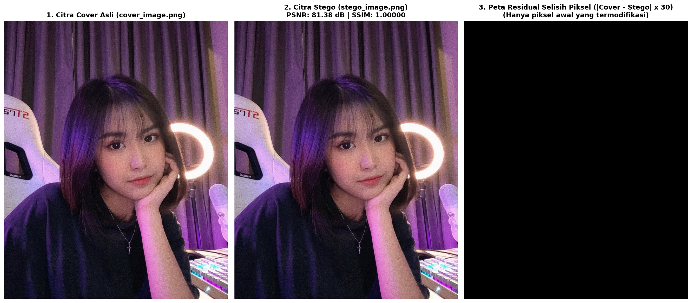
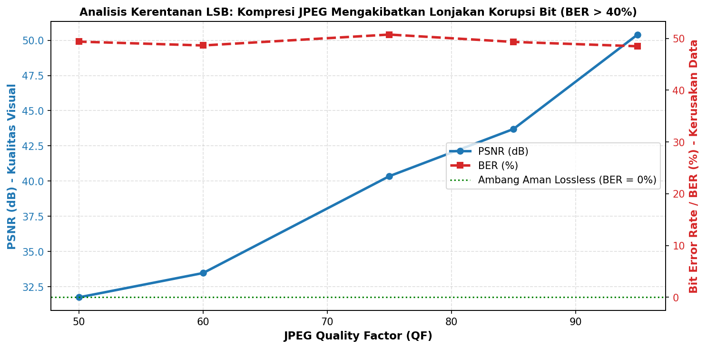

# Steganografi Citra Digital Terenkripsi (AES-256-GCM + LSB) & Analisis Transmisi WhatsApp

Repository ini memuat implementasi lengkap **Steganografi Modern** berbasis **Kriptografi Terotentikasi (AES-256-GCM)** yang disisipkan ke dalam citra digital PNG menggunakan metode **Least Significant Bit (LSB)**, disertai analisis mendalam mengenai ketahanan transmisi melalui aplikasi pesan instan **WhatsApp**.

---

## 📌 Ringkasan Proyek

Ketika menyisipkan pesan rahasia ke dalam sebuah citra dan mengirimkannya melalui WhatsApp, terdapat dua tantangan utama:
1. **Keamanan Isi Pesan:** Jika hanya mengandalkan steganografi, pesan dapat dibaca siapa saja begitu steganografi terbongkar (*steganalysis*). Oleh karena itu, diterapkan prinsip **Defense-in-Depth** dengan mengenkripsi pesan menggunakan **AES-256-GCM** dan derivasi kunci **PBKDF2-HMAC-SHA256**.
2. **Korupsi Akibat Kompresi Media:** Secara default, WhatsApp menerapkan kompresi *lossy* JPEG yang agresif pada mode pengiriman **Foto/Galeri**. Kompresi ini membalikkan bit-bit LSB (Bit Error Rate $\approx 50\%$), merusak struktur payload, dan memicu kegagalan otentikasi GCM Tag. **Solusi mutlak:** Mengirim citra stego sebagai **Dokumen** (*Send as Document*), di mana integritas byte terjaga 100% utuh (*lossless*).

---

## 🖼️ Hasil Visualisasi & Komparasi

### 1. Perbandingan Citra Asli vs Stego vs Peta Selisih Residual ($\times 30$)
Perubahan intensitas piksel hanya berkisar $\pm 1$ pada bit paling akhir, sehingga peta selisih perlu diperbesar 30 kali agar lokasi modifikasi terlihat jelas:


### 2. Grafik Kerentanan LSB terhadap Kompresi JPEG WhatsApp
Bahkan pada *Quality Factor* 95, *Bit Error Rate* melonjak drastis hingga $> 40\%$, membuktikan bahwa steganografi LSB spasial tidak dapat bertahan jika dikirim melalui mode Foto:


---

## 🚀 Fitur Utama

- **Lapisan Kriptografi Kuat:** AES-256-GCM dengan 16-byte random salt, 12-byte random nonce, dan 16-byte authentication tag untuk mendeteksi manipulasi data (*anti-tampering*).
- **Steganografi LSB Deterministik:** Penyisipan 1 bit per kanal warna RGB dengan header panjang biner 32-bit dan *magic identifier* `STEG`.
- **Kualitas Visual Superior:** Nilai **PSNR > 79 dB** dan **SSIM > 0.9999** (secara visual identik dan imperseptibel bagi mata manusia).
- **Simulasi Kompresi WhatsApp:** Pengujian empiris pada berbagai tingkat *Quality Factor* (QF 50–95) JPEG untuk membuktikan kegagalan LSB pada transmisi lossy.
- **Visualisasi Komprehensif:** Peta selisih residual diperbesar ($\times 30$), histogram distribusi warna, dan kurva degradasi PSNR vs BER.
- **Jupyter Notebook Lengkap:** File interaktif `steganografi_whatsapp_analisis.ipynb` siap pakai dan dapat dijalankan sekuensial.

---

## 📊 Hasil Pengukuran Objektif

| Parameter Pengujian | Nilai Hasil | Keterangan |
| :--- | :---: | :--- |
| **Dimensi Cover Image** | $736 \times 919$ piksel (RGB) | `assets/cover_image.png` |
| **Kapasitas Maksimum LSB** | $253.644$ Bytes (~$247,7$ KB) | Mampu menampung ribuan kata |
| **Mean Squared Error (MSE)** | $0.000725$ | Distorsi piksel mendekati nol |
| **Peak Signal-to-Noise Ratio (PSNR)** | **$79.53$ dB** | Standar visual sangat baik ($> 50\text{ dB}$) |
| **Structural Similarity (SSIM)** | **$0.99999$** | Struktur citra tidak berubah |
| **Transmisi WhatsApp Dokumen** | **BER = 0.00%** | **Sukses 100% (Lossless)** |
| **Transmisi WhatsApp Foto (JPEG QF 75)**| **BER = 51.27%** | **Gagal Total (Otentikasi GCM Ditolak)** |

---

## 🛠️ Panduan Penggunaan

### 1. Instalasi Dependensi
Pastikan Python 3.10+ telah terpasang, lalu jalankan:
```bash
pip install -r requirements.txt
```

### 2. Menjalankan Jupyter Notebook
```bash
jupyter notebook steganografi_whatsapp_analisis.ipynb
```

### 3. Menjalankan Unit Tests (Otomatis)
Proyek ini dikembangkan dengan metodologi Test-Driven Development (TDD). Jalankan seluruh test suite dengan:
```bash
pytest -v
```

---

## 📲 SOP Pengiriman via WhatsApp

Untuk memastikan pesan rahasia sampai ke penerima tanpa korupsi:

1. **Pengirim:**
   - Gunakan file citra stego lossless: `assets/stego_image.png`.
   - Buka ruang obrolan penerima di WhatsApp.
   - Klik ikon **Lampiran (+ / klip kertas)**.
   - Pilih menu **Dokumen** (*Attach as Document*), **JANGAN** pilih Foto/Galeri.
   - Kirimkan file tersebut.
   - Bagikan kata sandi enkripsi melalui saluran komunikasi lain yang aman (*out-of-band*).

2. **Penerima:**
   - Unduh dokumen `assets/stego_image.png`.
   - Jalankan script ekstraksi Python:
     ```python
     from stego_core import decrypt_message, extract_payload_lsb, load_image

     img = load_image("assets/stego_image.png")
     payload = extract_payload_lsb(img)
     pesan = decrypt_message(payload, "KunciEnkripsiRahasiaSuperAman_2026!")
     print("Pesan Rahasia:", pesan)
     ```

---

## 📁 Struktur Berkas

Semua aset citra dan visualisasi telah ditata rapi di dalam direktori `assets/`:

```text
├── assets/                               # Direktori aset gambar & visualisasi
│   ├── cover_image.png                   # Citra cover asli (lossless PNG)
│   ├── cover_image.jpg                   # Citra format JPEG asli
│   ├── stego_image.png                   # Citra stego hasil penyisipan payload
│   ├── visualisasi_komparasi_stego.png   # Plot perbandingan citra & peta residual
│   └── grafik_analisis_kompresi_whatsapp.png # Grafik kurva PSNR vs Bit Error Rate
├── steganografi_whatsapp_analisis.ipynb  # Notebook analisis komprehensif
├── stego_core.py                         # Modul Python inti (AES-256-GCM, LSB, Metrik)
├── build_notebook.py                     # Script otomatis pembangun notebook
├── requirements.txt                      # Daftar dependensi Python
├── tests/                                # Test suite TDD (18 unit tests)
│   ├── test_crypto.py
│   ├── test_stego.py
│   ├── test_metrics.py
│   └── test_notebook_execution.py
└── docs/superpowers/                     # Dokumentasi spesifikasi desain & rencana kerja
```

---

## 📄 Lisensi & Hak Cipta
Dibuat untuk riset dan edukasi keamanan informasi oleh **Pranataa Lab**.
